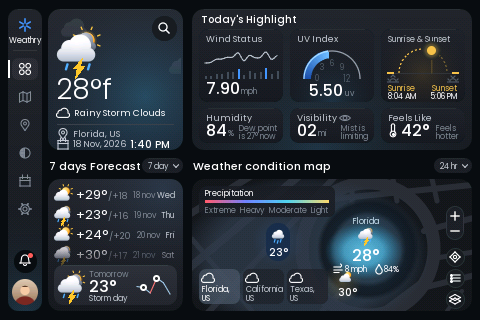

<div align="center">

# ESP32 Weather Dashboard

**Un panel del clima oscuro, con estilo de cristal, para ESP32 con una pantalla de 3.5" de 480 × 320.**
Datos en vivo de Open-Meteo. No necesita clave de API, ni cuenta en la nube, ni PSRAM.

[](https://github.com/itzSecretProject/esp32-weather-dashboard/actions/workflows/ci.yml)
[](https://www.espressif.com/en/products/socs/esp32)
[](https://github.com/espressif/arduino-esp32)
[](https://platformio.org)
[](https://open-meteo.com)
[](LICENSE)

[English](README.md) · [Español](README.es.md)



</div>

---

## Características

- **Clima actual:** ícono con sombreado, temperatura, descripción, ubicación, fecha y hora.
- **Today's Highlight:**
  - viento con su tendencia de 14 horas
  - medidor del índice UV
  - arco de amanecer y atardecer que sigue al sol
  - humedad con punto de rocío, visibilidad y sensación térmica
- **Pronóstico de 7 días** con la tarjeta *Tomorrow* y la curva de temperatura de mañana.
- **Mapa de condiciones:** leyenda de precipitación, marcadores en vivo de tres ciudades, controles y chips de ciudades.
- **Zona horaria y horario de verano automáticos** a partir de tus coordenadas.
- **Dibujo suave:** fuentes con antialiasing, degradados con tramado y actualizaciones sin parpadeo.
  Como dibuja por franjas, el ESP32 clásico no necesita PSRAM.
- **Vista previa en el escritorio:** genera un PNG con la misma interfaz del firmware, para cambiar el diseño sin flashear.

## Hardware

| Placa | Pantalla | Entorno |
|---|---|---|
| **ESP32-3248S035** ("Cheap Yellow Display 3.5\"", recomendada, sin cables) | ST7796 480 × 320 | `cyd35` |
| ESP32 DevKit + módulo SPI | ST7796 480 × 320 | `devkit-st7796` |
| ESP32 DevKit + módulo SPI | ILI9488 480 × 320 | `devkit-ili9488` |

Los pines, el cableado y cómo añadir otra placa están en **[docs/hardware.md](docs/hardware.md)** (en inglés).

## Inicio rápido

**1. Instala las herramientas.** Instala [VS Code](https://code.visualstudio.com/) y la extensión
[PlatformIO IDE](https://platformio.org/install/ide?install=vscode).

**2. Descarga el código.**

```bash
git clone https://github.com/itzSecretProject/esp32-weather-dashboard.git
```

```bash
cd esp32-weather-dashboard
```

**3. Añade los datos de tu Wi-Fi.** Git ignora este archivo.

```bash
cp include/secrets.example.h include/secrets.h
```

Luego edita `include/secrets.h`:

```cpp
#define WIFI_SSID      "nombre-de-tu-wifi"
#define WIFI_PASSWORD  "contraseña-de-tu-wifi"
```

**4. Pon tu ubicación** en [`include/config.h`](include/config.h). Consulta [Configuración](#configuración).

**5. Compila y flashea.** Conecta la placa y ejecuta:

```bash
pio run -e cyd35 -t upload
```

En VS Code, elige el entorno en la barra inferior y pulsa **Upload**.

## Configuración

Todo está en [`include/config.h`](include/config.h). El Wi-Fi va en `include/secrets.h`.

| Ajuste | Por defecto | Descripción |
|---|---|---|
| `LOCATION_NAME` | `"Paris, FR"` | Nombre de la ciudad principal |
| `LATITUDE` / `LONGITUDE` | `48.8566` / `2.3522` | Coordenadas en grados decimales |
| `MAP_CITY2_*`, `MAP_CITY3_*` | Londres, Madrid | Nombre y coordenadas de las otras dos ciudades del mapa |
| `USE_METRIC` | `1` | `1`: °C, km/h, km. `0`: °F, mph, mi |
| `USE_24H_CLOCK` | `1` | `1`: `17:05`. `0`: `5:05 PM` |
| `REFRESH_MINUTES` | `10` | Cada cuántos minutos se actualiza el clima |
| `BACKLIGHT_LEVEL` | `200` | Brillo de la pantalla, de `0` a `255` |
| `SCREEN_ROTATION` | `1` | `1`: horizontal. `3`: horizontal girada 180° |

> [!TIP]
> Para obtener coordenadas, haz clic derecho en un punto de Google Maps y luego clic en los números para copiarlos.

## Solución de problemas

| Problema | Solución |
|---|---|
| `include/secrets.h not found` | Copia `include/secrets.example.h` a `include/secrets.h` |
| Se queda en "Connecting to Wi-Fi" | Revisa los datos. El ESP32 solo funciona con redes de **2.4 GHz**. |
| "Couldn't get weather" | No hay acceso a internet. El monitor serie muestra el error HTTP. |
| Pantalla en blanco | Entorno o cableado incorrecto. Consulta [docs/hardware.md](docs/hardware.md#troubleshooting). |
| Colores invertidos o imagen al revés | Consulta [docs/hardware.md](docs/hardware.md#troubleshooting) |

## Desarrollo

La arquitectura, la vista previa en el escritorio, la generación de fuentes y la integración continua (CI)
están en **[docs/development.md](docs/development.md)** (en inglés).

## Créditos

- **Diseño de la interfaz:** adaptado del concepto *Weathry* de [MindInventory](https://dribbble.com/mindinventory).
  Este proyecto no está afiliado a MindInventory.
- **Datos del clima:** [Open-Meteo.com](https://open-meteo.com/), con licencia [CC BY 4.0](https://creativecommons.org/licenses/by/4.0/).
- **Gráficos:** [LovyanGFX](https://github.com/lovyan03/LovyanGFX). **JSON:** [ArduinoJson](https://arduinojson.org/).
- **Fuente:** [Poppins](https://fonts.google.com/specimen/Poppins) (SIL Open Font License 1.1).

## Licencia

[MIT](LICENSE). Los componentes de terceros conservan sus propias licencias.
