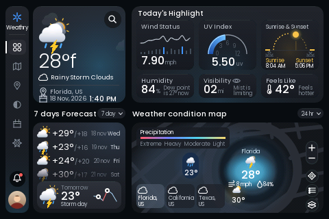
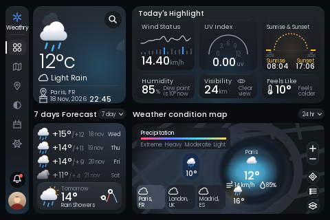
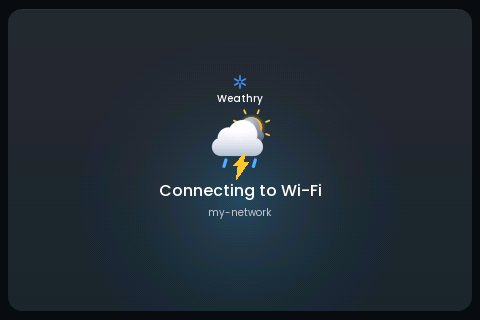

<div align="center">

# ESP32 Weather Dashboard

**A dark, glass-style weather dashboard for ESP32 with a 3.5" 480 × 320 display.**
Live data from Open-Meteo. No API key, no cloud account and no PSRAM needed.

[](https://github.com/itzSecretProject/esp32-weather-dashboard/actions/workflows/ci.yml)
[](https://www.espressif.com/en/products/socs/esp32)
[](https://github.com/espressif/arduino-esp32)
[](https://platformio.org)
[](https://open-meteo.com)
[](LICENSE)

[English](README.md) · [Español](README.es.md)



</div>

---

## Contents

- [Features](#features)
- [Hardware](#hardware)
- [Quick start](#quick-start)
- [Configuration](#configuration)
- [Project structure](#project-structure)
- [Desktop preview](#desktop-preview)
- [Troubleshooting](#troubleshooting)
- [Roadmap](#roadmap)
- [Credits](#credits)
- [License](#license)

## Features

- **Current conditions:** a shaded weather icon, temperature, description, location, date and time.
- **Today's Highlight:**
  - wind status with a 14-hour trend
  - a UV index gauge
  - a sunrise and sunset arc that tracks the sun
  - humidity with the dew point, visibility, and "feels like"
- **7-day forecast** with a *Tomorrow* card and tomorrow's temperature curve.
- **Weather condition map:** precipitation legend, live markers for three cities, map controls and city chips.
- **Automatic time zone and daylight saving**, from your coordinates.
- **Smooth rendering:** anti-aliased fonts, dithered gradients and flicker-free updates. Drawing in strips means
  the classic ESP32 needs no PSRAM.
- **Desktop preview:** renders the exact firmware UI to PNG, so you can change the design without flashing.

<table>
  <tr>
    <td></td>
    <td></td>
  </tr>
  <tr>
    <td align="center"><sub>Live data: rain at night, metric, 24-hour clock</sub></td>
    <td align="center"><sub>Status screen while connecting</sub></td>
  </tr>
</table>

## Hardware

| Board | Display | Environment |
|---|---|---|
| **ESP32-3248S035** ("Cheap Yellow Display 3.5\"", recommended, no wiring) | ST7796 480 × 320 | `cyd35` |
| ESP32 DevKit + SPI module | ST7796 480 × 320 | `devkit-st7796` |
| ESP32 DevKit + SPI module | ILI9488 480 × 320 | `devkit-ili9488` |

Pinouts, wiring diagrams and how to add a new board are in **[docs/hardware.md](docs/hardware.md)**.

## Quick start

**1. Install the tools.** Install [VS Code](https://code.visualstudio.com/) and the
[PlatformIO IDE](https://platformio.org/install/ide?install=vscode) extension. If you prefer the terminal,
install the [PlatformIO CLI](https://docs.platformio.org/en/latest/core/installation/index.html).

**2. Get the code.**

```bash
git clone https://github.com/itzSecretProject/esp32-weather-dashboard.git
```

```bash
cd esp32-weather-dashboard
```

**3. Add your Wi-Fi credentials.** This file is ignored by git.

```bash
cp include/secrets.example.h include/secrets.h
```

Then edit `include/secrets.h`:

```cpp
#define WIFI_SSID      "your-wifi-name"
#define WIFI_PASSWORD  "your-wifi-password"
```

**4. Set your location** in [`include/config.h`](include/config.h). See [Configuration](#configuration).

**5. Build and flash.** Plug in the board, then:

```bash
pio run -e cyd35 -t upload
```

```bash
pio device monitor
```

In VS Code, choose the environment in the status bar and click **Upload**.

## Configuration

Everything lives in [`include/config.h`](include/config.h). Wi-Fi credentials go in `include/secrets.h`.

| Setting | Default | Description |
|---|---|---|
| `LOCATION_NAME` | `"Paris, FR"` | Label for the main city |
| `LATITUDE` / `LONGITUDE` | `48.8566` / `2.3522` | Coordinates in decimal degrees |
| `MAP_CITY2_*`, `MAP_CITY3_*` | London, Madrid | Name and coordinates of the extra map cities |
| `USE_METRIC` | `1` | `1`: °C, km/h, km. `0`: °F, mph, mi |
| `USE_24H_CLOCK` | `1` | `1`: `17:05`. `0`: `5:05 PM` |
| `REFRESH_MINUTES` | `10` | Weather refresh interval |
| `BACKLIGHT_LEVEL` | `200` | Backlight brightness, `0`–`255` |
| `SCREEN_ROTATION` | `1` | `1`: landscape. `3`: landscape rotated 180° |

> [!TIP]
> To get coordinates, right-click any spot in Google Maps and click the numbers to copy them.

## Project structure

```
.
├── include/
│   ├── board.h              # display drivers and pin maps
│   ├── config.h             # user settings
│   └── secrets.example.h    # Wi-Fi template (copy to secrets.h)
├── src/
│   ├── main.cpp             # Wi-Fi, NTP, refresh loop
│   ├── ui/
│   │   ├── dashboard.cpp    # layout and drawing of every card
│   │   ├── icons.cpp        # shaded weather icons and outline glyphs
│   │   ├── gfx.h            # colour and dithering helpers
│   │   └── fonts.cpp        # generated anti-aliased fonts (Poppins)
│   └── weather/
│       ├── weather_api.cpp    # HTTPS requests to Open-Meteo
│       ├── weather_parse.cpp  # JSON → WeatherData
│       └── weather_data.h     # plain data model
├── tools/
│   ├── fonts/               # font sources and generator
│   └── preview/             # desktop renderer, fixtures, screenshot script
├── docs/                    # hardware and development guides, screenshots
└── platformio.ini           # build environments
```

The architecture, rendering pipeline and coding conventions are described in
**[docs/development.md](docs/development.md)**.

## Desktop preview

To work on the UI without hardware, render it to a PNG. You need CMake and SDL2.

```bash
cmake -S tools/preview -B build/preview -DCMAKE_BUILD_TYPE=Release && cmake --build build/preview -j
```

```bash
./build/preview/preview --weather tools/preview/fixtures/paris.json --out preview.png
```

To regenerate every screenshot in `docs/images/`, run `tools/preview/render-docs.sh`.

## Troubleshooting

| Problem | Fix |
|---|---|
| `include/secrets.h not found` | Copy `include/secrets.example.h` to `include/secrets.h` |
| Stuck on "Connecting to Wi-Fi" | Check the credentials. The ESP32 only supports **2.4 GHz** networks. |
| "Couldn't get weather" | No internet access. Check your router or firewall. The serial monitor shows the HTTP error. |
| Blank screen | Wrong environment or wiring. See [docs/hardware.md](docs/hardware.md#troubleshooting). |
| Inverted colors or upside-down image | See [docs/hardware.md](docs/hardware.md#troubleshooting) |

## Roadmap

- [ ] Touch navigation between pages (sidebar icons)
- [ ] Wi-Fi setup through a captive portal, without recompiling
- [ ] Over-the-air (OTA) updates
- [ ] Support for 800 × 480 ESP32-S3 RGB panels
- [ ] Localized UI strings

## Credits

- **UI design:** adapted from the *Weathry* weather dashboard concept by
  [MindInventory](https://dribbble.com/mindinventory). This project is not affiliated with MindInventory.
- **Weather data:** [Open-Meteo.com](https://open-meteo.com/), licensed under
  [CC BY 4.0](https://creativecommons.org/licenses/by/4.0/).
- **Graphics:** [LovyanGFX](https://github.com/lovyan03/LovyanGFX) by lovyan03 (FreeBSD license).
- **JSON:** [ArduinoJson](https://arduinojson.org/) by Benoît Blanchon (MIT license).
- **Font:** [Poppins](https://fonts.google.com/specimen/Poppins) by Indian Type Foundry (SIL Open Font License 1.1).

## License

Released under the [MIT License](LICENSE). Third-party components keep their own licenses, listed in [LICENSE](LICENSE).
